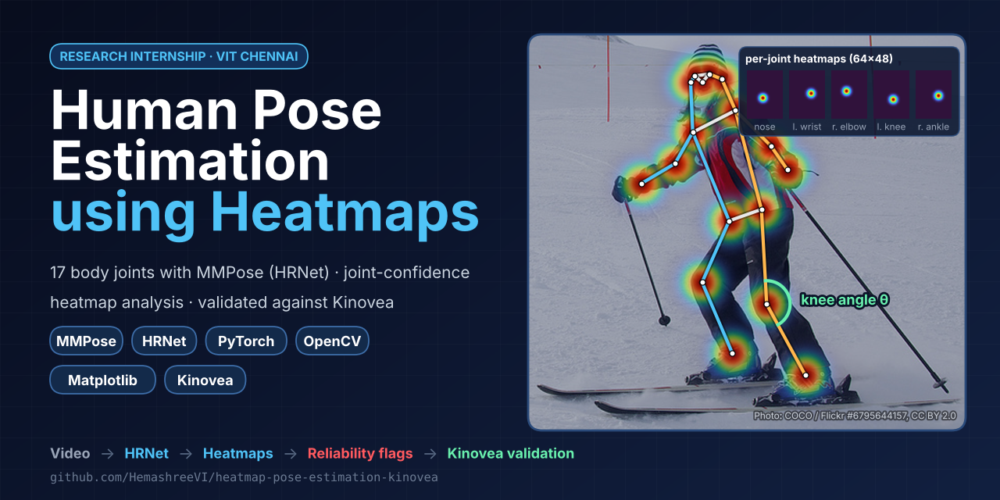
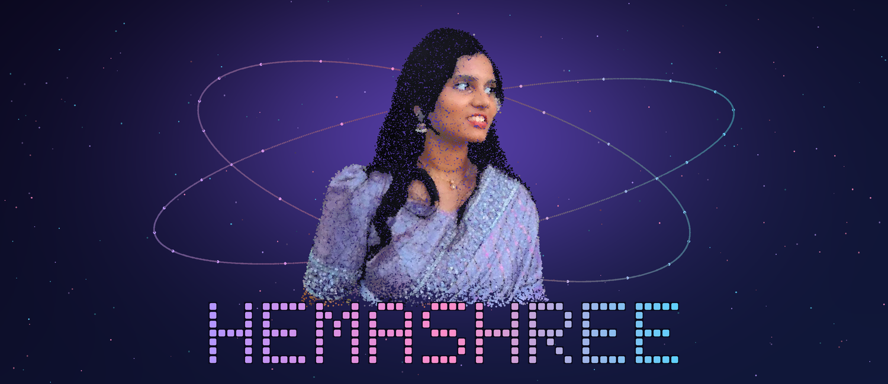

# Human Pose Estimation using Heatmaps



<sub>Illustration: COCO human-annotated keypoints drawn as the Gaussian heatmaps a heatmap model learns to predict.
Photo: COCO dataset / Flickr #6795644157, [CC BY 2.0](https://creativecommons.org/licenses/by/2.0/). Generated with `tools/make_preview.py`.</sub>

[](https://colab.research.google.com/github/HemashreeVI/heatmap-pose-estimation-kinovea/blob/main/notebooks/Human_Pose_Estimation_MMPose.ipynb)

Heatmap-based 2-D human pose estimation with **MMPose**, analysis of the
**joint-confidence heatmaps** with **OpenCV** and **Matplotlib**, and validation
of the predicted keypoints against **Kinovea** motion-analysis measurements.

*Research internship, VIT Chennai (May–Jul 2025). Stack: MMPose, OpenCV, Kinovea, Matplotlib, Python.*

> This is a rebuild of the internship code. The original Colab notebooks were lost.
> The method is the same, but any numbers have to be regenerated from your own
> videos and Kinovea data.

## What it does

| Step | Script | Output |
|---|---|---|
| 1. Pose estimation | `scripts/run_pose.py` | HRNet-W32 top-down heatmap model (COCO-17 joints). Saves keypoints, scores **and the raw 64×48 heatmap of every joint in every frame** |
| 2. Heatmap analysis | `scripts/analyse_heatmaps.py` | Heatmap overlays (OpenCV), 17-panel per-joint heatmap grids, confidence timelines, and per-joint reliability stats (Matplotlib) |
| 3. Kinovea validation | `scripts/compare_kinovea.py` | Keypoint error (px), RMSE, PCK, joint-angle MAE/RMSE, Bland–Altman, and whether low heatmap confidence predicts large errors |

### How the heatmaps are used to judge reliability
For each joint, the model's heatmap is projected back onto the image and three values are measured:

* **peak**: the confidence, i.e. the heatmap maximum (MMPose's keypoint score)
* **spread**: the spatial standard deviation of the blob in image pixels. A wide blob means the location is uncertain
* **second peak**: the strongest other local maximum divided by the main peak. A value near 1 means the model is torn between two places, such as left/right confusion or crossing limbs

A joint is flagged **unreliable** when `peak < 0.3`, `spread > 8% of the person box`, or
`second peak > 0.5` (all adjustable). The Kinovea comparison then checks whether flagged
joints really have larger errors.

## Quick start (Google Colab)

Open `notebooks/Human_Pose_Estimation_MMPose.ipynb` in Colab with a **GPU runtime** and run the cells in order.
The notebook doesn't need anything else from this repo: it writes all the code itself.

The first install compiles MMCV from source, which can take 30–60 min on Colab. The compiled wheel is
cached in Google Drive, so later sessions install it in seconds.

## Local install (Linux, Python 3.10–3.12)

```bash
pip install torch torchvision            # pick the CUDA build for your machine
pip install "setuptools<70" ninja "mmengine==0.10.7" json_tricks munkres opencv-python matplotlib pandas scipy openpyxl
pip install --no-cache-dir --no-build-isolation xtcocotools       # must be built against your NumPy
MMCV_WITH_OPS=1 pip install --no-build-isolation "mmcv==2.2.0"   # compiles; needs torch already installed
pip install --no-deps "mmpose==1.3.2" "mmdet==3.3.0"              # --no-deps skips chumpy (breaks on py3.12)
# mmpose imports mmdet utils; mmdet asserts mmcv<2.2.0 although 2.2.0 works -> relax the check:
sed -i "s/mmcv_maximum_version = '2.2.0'/mmcv_maximum_version = '2.3.0'/" \
    "$(python -c 'import importlib.util; print(importlib.util.find_spec("mmdet").origin)')"
```

Why it's done this way:

* **MMCV** is built from source because OpenMMLab has no prebuilt wheels for recent PyTorch.
* **setuptools<70** is needed because MMCV's `setup.py` still imports `pkg_resources`.
* **mmdet** is installed only because MMPose imports a few of its utilities. Its MMCV version check is relaxed, and people are detected with torchvision's Faster R-CNN, not mmdet.
* **xtcocotools** has to be compiled against the NumPy you have installed. Otherwise you get `numpy.dtype size changed`.

## Usage

```bash
# 1. pose estimation (video, image, or folder of frames)
python scripts/run_pose.py --input data/trial.mp4 --out results/trial
#    --no-detector   whole frame = person box (subject fills the frame)
#    --model resnet50 | hrnet-w48,  --stride 2,  --max-frames 300,  --device cpu

# 2. heatmap analysis (+ overlay video)
python scripts/analyse_heatmaps.py --results results/trial --video
python scripts/analyse_heatmaps.py --results results/trial --video --joint left_knee

# 3. Kinovea validation
python scripts/compare_kinovea.py --kinovea data/trial_kinovea.csv --inspect     # see the columns
cp data/kinovea_mapping_example.json data/kinovea_mapping.json                   # edit column names
python scripts/compare_kinovea.py --results results/trial --kinovea data/trial_kinovea.csv \
       --mapping data/kinovea_mapping.json --auto-offset 10
```

### Kinovea data
Track the joints in Kinovea on the **same video**, using the trajectory tool and/or angle tools,
and export to CSV or XLSX. Because the export layout differs between Kinovea versions and
languages, a small JSON mapping tells the loader which column is which:

```json
{
  "time_column": "Time (ms)", "time_unit": "ms",
  "points": {"left_knee": {"x": "Knee/X", "y": "Knee/Y"}},
  "angles": {"left_knee": "Knee angle"},
  "coords": {"px_per_unit": 1.0, "origin_px": [0, 0], "y_up": false}
}
```

* Joint names must be COCO names (`left_knee`, `right_ankle`, …).
* Files that use `;` as the separator and `,` as the decimal mark are handled automatically.
* `coords` converts Kinovea's coordinate system into image pixels. If Kinovea was calibrated
  in metres, compare **joint angles**: they don't depend on units.
* `--auto-offset N` fixes a start-time mismatch by searching ±N frames.
* `--auto-align` fits scale and offset automatically. Use it only when the coordinate system is
  unknown, because it also hides any global bias of the model.

## Outputs

```
results/<name>/
  keypoints.csv  heatmaps.npz  meta.json
  heatmap_analysis/   heatmap_metrics.csv, joint_summary.csv, confidence_timeline.png,
                      joint_summary.png, confidence_vs_spread.png, grid_frame_*.png,
                      overlay_frame_*.jpg, heatmap_overlay.mp4
  kinovea_validation/ keypoint_summary.csv, angle_agreement.csv, confidence_vs_error.csv,
                      error_per_joint.png, trajectory_<joint>.png, angles.png, report.json
```

## Repo layout

```
posestudy/   skeleton.py (COCO joints, angles) · estimator.py (MMPose) · heatmaps.py · kinovea.py
scripts/     run_pose.py · analyse_heatmaps.py · compare_kinovea.py
notebooks/   Colab notebook (generated by tools/build_notebook.py; re-run it after editing code)
docs/assets/ README banner (generated by tools/make_preview.py)
tests/       test_synthetic_pipeline.py: checks steps 2–3 on synthetic data, no MMPose needed
```

## About the author

<p align="center">
  
</p>

Built during my research internship at VIT Chennai (May–Jul 2025) under Prof. Pavithra,
then rebuilt and extended as this open-source project. GitHub: [@HemashreeVI](https://github.com/HemashreeVI)

## License

[MIT](LICENSE)
